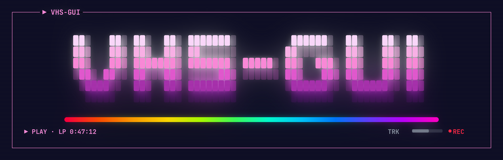

# vhs-gui — VHS Capture & Playback GUI



[](LICENSE)


[](https://github.com/RyanEiri/vhs-gui/releases)

<details>
<summary>Terminal version</summary>

```
+----+ > VHS-GUI +------------------------------------------------------------+
|                                                                             |
|         ##.   ##. ##.  ##. #######.         ######.  ##.   ##. ##.          |
|         ##:   ##: ##:  ##: ##......        ##......  ##:   ##: ##:          |
|         ##:   ##: #######: #######. #####. ##:  ###. ##:   ##: ##:          |
|         .##. ##.. ##...##: .....##: ...... ##:   ##: ##:   ##: ##:          |
|          .####..  ##:  ##: #######:        .######.. .######.. ##:          |
|           .....   ...  ... ........         .......   .......  ...          |
|                                                                             |
|         .:######################################################:.          |
|  > PLAY - LP 0:47:12                                      TRK ===..  * REC  |
+-----------------------------------------------------------------------------+
```

`cat banner.ans` in a 256-color terminal for the vibrant ANSI-colored version.

</details>

A native Rust desktop application that wraps VHS digitization — capture,
processing, playback, and AI upscaling — in a single window. It's the primary
day-to-day interface for tape digitization.

**This is a self-contained Rust application.** It does not call or depend on any
external pipeline scripts. Operations it performs (deinterlace, upscale, denoise,
etc.) are implemented natively in Rust, spawning only the underlying media tools
directly (ffmpeg, VapourSynth's `vspipe`, Real-ESRGAN) — never a wrapper script.
This is a deliberate, ongoing migration (see "Native-Rust port status" below). Only the
upscale *Script* engine (the default until a real tape-length upscale matches the native one) still
shells out to scripts from the sibling [vhs-cli](https://github.com/RyanEiri/vhs-cli) repo;
everything else is native.

There's also a bash/CLI version of this same pipeline,
[vhs-cli](https://github.com/RyanEiri/vhs-cli) — useful for terminal/scripted
workflows. The two are independent sibling projects; this repo has no dependency on
that one beyond the transitional script paths noted above.

**Expected local layout:** this repo lives at `~/Videos/vhs-gui/`, a sibling of the
data directories (`~/Videos/captures/`, `~/Videos/logs/`, etc.) which are not part of
this repo — they're local working directories referenced by absolute path from
`src/config.rs`.

## Hardware

Built and run on a single Linux workstation:

- **CPU:** AMD Ryzen 9 5900X (12-core).
- **GPU:** AMD Radeon RX 7800 XT (RDNA 3, gfx1101) — drives Real-ESRGAN upscale
  jobs via either backend (ROCm/PyTorch or Vulkan/ncnn; see the Upscale Settings
  panel). ROCm is required for the community VHS-specific models — the Vulkan
  binary segfaults on any model name outside its hardcoded family list.
- **VHS capture device (the flakiest link in the pipeline):** MacroSilicon
  MS210x USB video grabber — a low-cost USB2.0 analog capture dongle
  ("EasierCAP"-type). Opened via V4L2 at a stable `/dev/v4l/by-id/...` path
  (`src/config.rs`'s `v4l2_device` default) so it survives USB port changes;
  override it for different capture hardware. A fair amount of this app's
  capture-side code exists specifically to work around this device's quirks:
  - **Exclusive access.** Only one process can hold its V4L2 fd at a time, so
    handing off from the live Monitor to a capture can't just start the second
    process: the monitor's hold has to actually clear first. The monitor is a
    small ffmpeg process (`src/monitor_feed.rs`) sending a UDP preview that mpv
    plays, so the `Releasing` capture state (`src/panels/monitor.rs`) simply
    waits until that process has exited. (mpv used to open the grabber itself;
    closing it crashed the GUI inside libmpv/libavdevice, so it no longer does.)
  - **Spurious preview drops.** The live-preview stream sometimes goes idle
    on its own mid-capture even though ffmpeg is still recording correctly
    in the background. Rather than surface that as an error, an "insurance
    reopen" (throttled to once per 2s, `src/panels/monitor.rs`)
    automatically reconnects mpv to the preview stream.
  - **Slow USB control transfers.** Setting brightness/contrast/hue/etc. via
    `VIDIOC_S_CTRL` can block for multiple seconds on this device. `src/
    v4l2.rs` issues every control write from a dedicated background thread
    over a bounded channel specifically so a slow ioctl never freezes the
    UI thread — see the comment above the thread spawn there.
  - Video and audio are two independent USB interfaces on the same dongle,
    not a hardware-synced A/V pair — they drift over a long capture. Native
    "Fix A/V Sync" corrects this after the fact.
- **Not used by this app, but worth noting:** the same machine also has a
  Blackmagic Design Intensity Pro PCIe capture card, used only by vhs-cli's
  separate OBS `game` env slot for console capture (unrelated to VHS
  digitization — this app never touches it). The cheap USB dongle above is
  the one that actually works; the "proper" dedicated capture card
  currently doesn't. Failure details and log evidence are in the
  [vhs-cli README](https://github.com/RyanEiri/vhs-cli#hardware), since
  that's the repo that owns the OBS config and logs it's diagnosed from.
- **Scratch storage:** a secondary drive mounted at `/media/Patriot`.
  `Videos/vhs_upscale_work/` there holds the segment checkpoints for
  chunked/resumable upscale jobs, and `~/Videos/captures/{archival,stabilized,viewer}`
  are symlinks into `/media/Patriot/Videos/captures/`.

## Build & Launch

```bash
cd vhs-gui
cargo build            # debug
cargo build --release  # optimized, for system install

DISPLAY=:0 ./target/debug/vhs-gui           # run debug build
DISPLAY=:0 ./target/release/vhs-gui         # run release build
```

### System-wide install

```bash
cargo build --release
sudo install -m 0755 target/release/vhs-gui /usr/local/bin/vhs-gui
./install-desktop.sh   # installs the .desktop entry + icon, points Exec at /usr/local/bin/vhs-gui
```

## Stack

- `eframe`/`egui` 0.34 (glow/OpenGL backend, Wayland via winit)
- `libmpv2` 6.0.0 — render API, off-screen FBO, blitted via an egui paint callback
- `nix` — SIGINT/SIGSTOP/SIGCONT to process groups (pause/resume/cancel jobs)
- `image` (JPEG only) — decodes upscale preview frames
- `trash` — FreeDesktop.org trash (recoverable deletes)
- `png` — decodes the embedded window icon
- `serde` + `toml` — settings persistence (`~/.config/vhs-gui/config.toml`)

## What It Does

- **Monitor** — a live signal check before recording: a small ffmpeg process reads the V4L2
  capture device and sends a low-latency preview that mpv plays over UDP. The feed is stopped and
  has exited before a capture starts, and it is terminated by the kernel if the GUI dies.
- **Start/Stop Capture** — spawns the capture process; the archival file opens in
  the embedded player as soon as it appears on disk, with a rolling near-live
  preview window. Ctrl+C/SIGINT during capture is a normal stop, not a failure.
- **Capture length** — the **Cap** field arms a stop timer when a capture starts (it is disabled while capturing); **Stop after** / Set re-arms that timer up or down at any time, so a running capture can be extended as well as shortened. ffmpeg itself runs with a fixed 6 h safety cap as a backstop.
- **Library panel** — five sections in display order: Viewer → Edit Master (VD) →
  Edit Master → Stabilized → Archival. Click any entry to open it in the player.
- **Upscale engine** — the upscale settings have an **Engine** choice: *Script* (the original bash
  scripts, the default) or *Native (beta)*, a built-in engine run as a detached worker so a job still
  outlives the GUI. Native covers every Upscale button (plain, Anime, B&W).
  On a test clip it produced output bit-identical to the script's.
- **Pipeline actions** — per-section buttons launch Denoise, QTGMC, IVTC, VDecimate,
  Viewer Encode, and all upscale variants as background jobs. Only one job runs at a
  time; buttons are disabled while busy.
- **Audio Cleanup** — native hum notch, SoX noise reduction and two-pass loudnorm for Edit Master, Edit Master (VD) and Viewer files, plus a **Find Quiet Spot** scan to pick the noise-sample window.
- **Upscale jobs** — dual progress bars (total segments / completed; upscaled frames
  / extracted frames for the active segment). Pause (SIGSTOP), Resume (SIGCONT),
  Stop after Segment (clean SIGINT at the next segment boundary), Cancel (immediate
  SIGINT). A side-by-side "Original vs Upscaled" preview updates every 4 seconds
  while a job runs. Final Scale is kept compatible with the model's internal
  scale (a 1x model such as VHS-Sharpen-1x forces 1x). A running job outlives the GUI: a new instance reattaches to
  it (identity-checked via the job's process-group lock) instead of starting a
  second one.
- **Rename** — Viewer files get a title-suggestion field pre-filled from the
  filename (strips pipeline suffixes/prefixes, title-cases with acronym
  preservation, formats with an em dash).
- **Delete** — moves files to the FreeDesktop.org trash, recoverable from any file
  manager.

**Capture state machine:** `Idle → Monitoring → Releasing → Capturing`. The V4L2 device is
exclusive to one ffmpeg at a time: Releasing waits for the monitor feed to exit, then the capture
starts and mpv plays the capture's own UDP preview.

## Native-Rust port status

`vhs-gui` is migrating away from bash pipeline scripts toward being self-contained. Done: the tools
resolver, embedded VapourSynth scripts, Viewer Encode, Denoise and Denoise+QTGMC, capture and
monitor, and the upscale engine for all three variants (selectable as *Native (beta)*). Left: making
native the default and deleting the script call sites (waits on a tape-length upscale that matches
the script), VapourSynth setup on a fresh machine, and a portable package. `src/config.rs` marks the
remaining script accessors with `// TODO(native-port)`. The plan and to-do list are in
[`ROADMAP.md`](ROADMAP.md).

## System dependency notes

- **Install steps for every external tool, with what was and was not tested: [`docs/INSTALL.md`](docs/INSTALL.md).**
- Requires the `libmpv2` runtime.
- System `ffmpeg` 8.0.1 at `/usr/bin/ffmpeg`; SoX for the audio-cleanup chain. Every external
  tool is found through one resolver (`src/tools.rs`): a `VHS_GUI_<TOOL>` environment override
  (`VHS_GUI_FFMPEG`, `_FFPROBE`, `_SOX`, `_VSPIPE`, `_REALESRGAN_ROCM`, `_REALESRGAN_NCNN`),
  then a bundled copy, then `/usr/bin`, then `~/bin` and `PATH`. The 🔧 Tools window in the left
  rail shows what was found and the version; the toolbar warns when something is missing.
- `realesrgan-rocm` shim at `~/bin/realesrgan-rocm` for the ROCm upscale backend; its source
  (`driver.py`, `requirements.txt`, the shim) is in [`tools/realesrgan-rocm/`](tools/realesrgan-rocm/).
  Model weights aren't bundled with this repo — grab pre-packaged archives
  (official + community VHS-tuned, both `.pth` and ncnn formats) from
  [vhs-cli's `models-v1` release](https://github.com/RyanEiri/vhs-cli/releases/tag/models-v1).
- VapourSynth R55 (`/usr/bin/vspipe`, PPA build) + `PYTHONPATH` pointing at
  `~/.local/share/vsrepo/py` (needs only `havsfunc` and `vsutil`) for the deinterlace/telecine
  operations. `vspipe` embeds Python 3.12 (the system Python is 3.14), so keep the `libpython3.12`
  packages installed. R81 from PyPI (Python 3.14) also works: the plugin loader and a znedi3 shim
  handle it; see `ROADMAP.md` Phase 6a.
- Built with Rust 1.98 (edition 2024) on Ubuntu 26.04.1.
